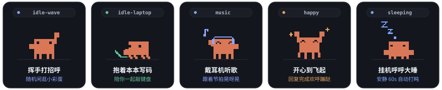

<div align="center">



# 🦀✨ AGY Claude Style (`agy-claude-style`)

**让会眨眼、会摸鱼、还能被挠痒痒的像素小螃蟹 `Clawd` 陪你在 Google Antigravity 里写代码** `(๑•̀ㅂ•́)و✧`

为 **Google Antigravity**（Windows / macOS / Linux）打造的一体化界面重塑、多语言本地化与 Token HUD 遥测增强插件。<br/>
基于 Antigravity 内置 **Chrome DevTools Protocol（CDP）** 调试端口实现无损动态注入——**不改动任何原版安装文件**，支持热更新与一键无痕退潮还原 🌊

<p>
  <a href="#clawd-饲养指南"></a>
  <a href="#快速开始"></a>
  <a href="#核心特性"></a>
  <a href="#核心特性"></a>
  <a href="#环境要求"></a>
  <a href="LICENSE"></a>
</p>

[✨ 核心特性](#核心特性) · [🧰 Powertools & 控制室](#powertools-控制室) · [🦀 Clawd 饲养指南](#clawd-饲养指南) · [🚀 快速开始](#快速开始) · [⚙️ 配置调教](#配置说明) · [🗂️ 项目结构](#项目结构) · [💌 来源声明](#来源声明)

</div>

> [!NOTE]
> **来源与贡献致谢**：本项目灵感及部分源码来源于 [Nwflower/dsh-claude-style](https://github.com/Nwflower/dsh-claude-style)；Codex 思考强度滑杆样式来源于 [Microqian2th/dsh-codex-effort-slider](https://github.com/Microqian2th/dsh-codex-effort-slider)；梁武峰思考强度滑杆样式来源于 [mobius/dsh-performance-slider](https://github.com/mobius/dsh-performance-slider)。原生插件宿主、三页签控制室与 Powertools 效率套件源自 [@NoFires](https://github.com/0DNANCY/agy-claude-style/pull/19)，长对话布局性能优化源自 [@liuhaodongliu990-cmyk](https://github.com/0DNANCY/agy-claude-style/pull/21)。详见 [来源声明](#来源声明)。

---

<a id="目录"></a>
## 🗺️ 目录

- [✨ 核心特性](#核心特性)
  - [🧰 Powertools 效率套件 & 3 页签控制室 (`v2.2.0`)](#powertools-控制室)
  - [📢 阶段汇报提示词注入说明 (`stagePromptInjection`)](#阶段汇报提示词注入说明)
- [🦀 小螃蟹 Clawd 饲养指南](#clawd-饲养指南)
- [🎒 环境要求](#环境要求)
- [🚀 快速开始（Antigravity Desktop 原生插件）](#快速开始)
  - [🪟 方式一：Windows 原生插件一键安装器（`.exe`）](#方式一windows-原生插件一键安装器exe)
  - [🍎 方式二：macOS 原生插件一键安装应用（`.dmg` / `.app`）](#方式二macos-原生插件一键安装应用dmg--app)
  - [🔌 方式三：手动克隆 / 本地插件加载（Windows / macOS / Linux）](#方式三手动克隆--本地插件加载windows--macos--linux)
- [⚙️ 配置说明 (`config.json`)](#配置说明)
- [🗂️ 项目结构](#项目结构)
- [🧪 开发、测试与构建](#开发测试与构建)
- [💌 来源声明](#来源声明)
- [📜 开源协议](#开源协议)

---

<a id="核心特性"></a>
## ✨ 核心特性

### 🌌 1. Studio 首页、液态玻璃与会呼吸的字符波纹海
- **保留原生特征与主题配色**：首页顶部保留 Antigravity 原生拱形 Logo（支持 `accent` / `foreground` 配色切换），与问候语水平对齐；提供 `obsidian`（黑曜石蓝暗色）、`claude` 与 `host`（跟随宿主）三套调色板，自动适配深色与浅色主题 🎨。
- **液态玻璃 & 对话紧凑排版 (`glassEffect` / `compactChatLayout`)**：为浮窗、卡片、输入胶囊与菜单提供细腻的液态玻璃半透明磨砂质感；开启 `compactChatLayout` 可收窄对话气泡、工具卡片与标题行留白，一屏浏览更多内容。
- **实时字符矩阵波纹场 (`homeRipple`)**：在首页铺设等宽字母数字二维波动网格，带云雾漂移氛围效果；轻点空白处就像把小石子丢进字符星空，触发柔和的阻尼水波纹扩散动画 `~(˘▾˘~)`。
- **编程用量仪表盘 (`概览` / `模型` · `全部` / `30 天` / `7 天`)**：自动聚合本地对话轨迹并剔除子代理重复会话计数，展示 6 项核心指标（会话数、消息数、Token 总量、活跃天数、高峰时段、最常用模型）、`26×7` 周日历热力图、30d/7d 模型堆叠柱状图，以及**60+ 本经典著作 Token 折算标尺**——悄悄告诉你今天写的代码相当于读了几本《爱丽丝漫游奇境》或《哈利·波特》📖✨。

### ⌨️ 2. 极简重排输入框、丝滑光标与温柔侧栏
- **极简输入框 (`composerRestyle`)**：将工作区与环境选择胶囊重排为 `28px` 极简细边样式，底栏控件轻巧落于画布之上，支持 `studio` / `host` 提示占位风格（`placeholderStyle`）。
- **丝滑打字光标 (`smoothCaret`)**：为输入框渲染平滑插值位移动画光标（`.ag-cs-smooth-caret`），兼容多行换行与中文输入法（IME）候选输入态，并在输入框未聚焦时自动跳过布局测量，零强制同步重排（`Fixes #20`）🍫。
- **侧栏样式优化 (`sidebarRestyle` / `sidebarCompact`)**：统一侧边栏行高与悬停高亮板，支持开启更紧凑的条目间距。

### 🎚️ 3. 三风格交互式思考强度滑块 (`effortSliderStyle`)
点击模型名旁的思考强度徽章（`Low` / `Medium` / `High` / `XHigh` / `Max` 等级映射，精准匹配同上下文窗口档位如 `200k` / `1M` 并保留宿主 `Extra` 标识），弹出可视化推理档位滑块调节器：
- **Claude Code (`claude`)**：5 行动态矩阵噪声点阵、发光竖向胶囊滑块与 `effortAccent` 蓝紫渐变色阶。
- **ChatGPT Codex (`chatgpt`)**：蓝→紫渐变进度条、高档位星云扫光、星空粒子及阻尼刻度手感 ✨。
- **梁武峰 (`liangwufeng`)**：内置 31 帧 320×320 WebP 抠像人像背景，支持 `performanceBackdrop`（`card` 卡片内 / `page` 全窗口 / `off` 关闭）三种渲染模式。

### 📊 4. 贴心 Token HUD 与右下角电量小圆环
- **右下角剩余用量圆环 (`ringMode` / `quotaCycleMode`) & 低余量告警**：支持在**当前上下文剩余可用百分比 (`context`)** 与**模型配额剩余百分比 (`quota`)** 之间切换，支持 `quotaCycleMode`（`auto` 自动 / `5h` 5 小时配额 / `weekly` 周配额）按需查看；随剩余容量动态变色提示（🔵 `>30%` 元气满满 · 🟡 `≤30%` 注意补水 · 🔴 `≤10%` 快见底啦）；当上下文余量 **`≤20%`（黄色提醒）** 或 **`≤10%`（红色紧急告警）** 时，支持一键点击横幅或 `/compact` 向当前对话精准填入 `/compact`。
- **每轮对话 Token 徽章 (`turnBadges`)**：在每轮 AI 回复底部展示 `#T{n}` 模型名、上下文总量与本轮增量、输出与思考 Token、工具调用次数、子代理汇总、输出速率（`tok/s`）及缓存命中率。
- **4 标签页深度遥测浮窗**：支持上下文拆分、对话轮次、工具与子代理统计、模型配额池剩余百分比与 5h / 周重置倒计时 ⏳。
- **可选环绕式 HUD**：提供 `hudTopBar`、`hudBottomBar`、`hudRimProgress`（配合 `hudRimSource`: `auto` / `context` / `quota`）、`hudFooterChip`、`hudCompact` 五项可折叠增强开关，默认关闭，按需启用。

### 🦀 5. 像素螃蟹小跟班 `Clawd` (`mascot`)
- 在输入框右上角蹲着一只超有戏的像素小螃蟹 `Clawd`（内置 **19 套双层精灵图动画**），会跟着对话节奏在 `idle`、`thinking`、`typing`、`error`、`sleeping`、`waking` 等状态间切换，无聊了还会自己抱着小本本摸鱼或对你招手 👋。
- **礼貌满分**：当输入框上方出现排队消息、`/` 命令菜单或问答确认卡片时，Clawd 会自觉调整留白或悄悄躲起来，绝不遮挡发送、编辑、删除等按钮。

### 🌐 6. 5 语言全局切换 & 双入口设置实时同步
- **5 语言全局本地化 (`language`)**：支持 **简体中文 (`zh-CN`) / 繁體中文 (`zh-TW`) / 粵語 (`yue`) / English (`en`) / 日本語 (`ja`)** 实时切换，作用于 Antigravity 主界面、Plan / Orchestrator 编排模式、插件面板以及 **Swarm 蜂群侧栏 (`plugin://swarm--` OOPIF)**；自动跳过代码编辑器、终端、对话/帖子正文与 `data-ag-no-i18n` 保护区，移除插件时无损还原。
- **双入口实时同步**：同时保留 **Antigravity 原生 `设置 → 外观` 底部完整可视化设置组** 与 **右侧栏「控制室」页签**——无论你在哪一处修改设置，均通过校验与原子写入持久化到 `config.json`，并在 3-way 合并机制下即时双向同步生效。

---

<a id="powertools-控制室"></a>
### 🧰 7. Powertools 效率套件 & 右侧 3 页签控制室 (`v2.2.0`)

`v2.2.0` 新增模块化效率增强套件 (`features/*.js`) 与独立侧栏控制室 (`sidecars/panel/`)：

- **⏳ 时间旅行撤销 (`rewindPanel` / `doubleEscRewind`)**：支持在输入框连按两次 `Esc` 呼出快捷回退条，或点击历史消息原生 `Undo` 按钮打开「**对话 + 代码 / 仅恢复对话 / 仅恢复代码 / 取消**」确认面板（支持 `undoConfirmMode`: `picker` / `auto-conversation` / `auto-both`），自动异步加载代码 diff 预览并完整保留 Lexical 编辑器中的换行、缩进与文件引用。
- **🌿 对话分叉与原地编辑 (`branchSession` / `messageEdit`)**：
  - 在任意助手回复工具栏一键**从此处分叉会话**（调用 `forkConversation` 并保留工作区，新开分支尝试不同方案）；
  - 双击或点击用户消息的编辑按钮即可**原地编辑并重发**，自动回退轨迹到对应步骤。
- **📎 文件链接右键菜单 (`fileContextMenu`)**：点击对话里的文件/路径引用直接弹出操作菜单——「本地打开 / 在访达或资源管理器定位 / 复制完整路径 / 用已检测的外部编辑器或终端打开（自动携带 `:行:列` 跳转参数）/ 作为 `@引用` 插入当前输入框」，内置 UNC 网络路径与 Windows `.cmd` 敏感字符拦截。
- **📋 任务进度浮动卡片 (`taskProgressCard`)**：自动汇总当前任务的工具执行步骤、Markdown `- [x]` 清单完成度、重试原因分类（EOF / 超时 / 限流 / 上游繁忙 / 区域受限）与实时等待计时，支持自由拖拽悬浮位置或停靠在顶部。
- **📌 扩展坞快捷固定 (`headerExtensionsBar` / `sidebarExtensionsSection`)**：将常用扩展侧栏固定在顶部标题栏或左侧边栏快捷开关。
- **🔔 窗口后台未读提醒 (`windowUnreadTitle`) & 关闭隐藏托盘 (`hideOnClose`)**：对话在后台等待审批或完成时自动更新窗口标题角标，聚焦后清除或继续跟踪其余后台会话；点击关闭按钮时支持最小化隐藏而非直接杀进程。
- **📂 阶段自动折叠与进度汇报 (`stageCollapse` & `stagePromptInjection`)**：在长任务多轮执行过程中自动把阶段更新与中间工具组折叠收纳，完成回合默认收起为原生可展开组件；是否向模型追加进度汇报提示词可由 `stagePromptInjection` 单独控制（详见下方透明说明）。
- **🎛️ 侧栏 3 页签控制室 (`sidecars/panel/`)**（通过原生插件模式或控制面板访问）：
  - **仪表盘 (Dashboard)**：本地 + SSH 远程 JSONL 流式遥测统计、53 周贡献日历热力图、缓存骤降异常检测、模型健康度时间线与 TTFT / Streaming TPS 分离分析、LiteLLM 官方参考定价同步与 5 小时 / 周配额追踪。
  - **控制室 (Control)**：一站式调节全量视觉样式、HUD、Powertools、阶段提示词注入开关与代理参数。
  - **远程与代理 (Remote & Proxy)**：SSH 远端工作站历史轨迹汇总（支持 `~/.ssh/config` 主机发现），以及面向 Windows 非 TUN 代理环境的独立代理配置与冷启动告警。

<a id="阶段汇报提示词注入说明"></a>
> [!WARNING]
> **透明机制说明：关于「阶段汇报提示词注入（`stagePromptInjection`）」**
>
> 为了配合 **阶段自动折叠（`stageCollapse`）** 让模型在长任务执行期间输出结构化中间进度，本插件内置了可选的 `agy_cs_stage_updates` 系统提示词附加机制。**从 `v2.2.0` 起，UI 折叠与提示词注入已严格解耦：**
> - **`stageCollapse`（默认 `true` 开启）**：仅负责前端渲染层——实时内联展示阶段日志并在回合完成后自动折叠归档工具与阶段分组，**不会改动任何发送给模型的提示词**。
> - **`stagePromptInjection`（默认 `false` 关闭）**：只有当你**主动开启**此开关时，插件才会 Hook Antigravity 发送管线并将 `noToolExplanation`/`noToolSummary` 设为 `false`，同时在 `CascadeConfig.plannerConfig.promptSectionCustomizationConfig.appendPromptSections` 末尾追加如下英文提示段（标题为 `agy_cs_stage_updates`）：
>   ```text
>   During this task, communicate brief visible progress updates in the user-facing response alongside tool calls. Before the first substantial tool action, write one concise sentence explaining the immediate next action and its purpose. After a meaningful finding, change of direction, or a few execution steps, write one or two concise sentences stating the result and next action. These are intermediate updates, not final answers: continue executing the task after each update. Do not narrate every command. Do not put updates only in private thinking, tool summaries, task artifacts, or notify_user. Use the user language. Never invent progress or expose private reasoning.
>   ```
> - **Token 与缓存提示**：注入上述约 100 词规则会略微增加每次请求的输入上下文与输出阶段文本；仅建议在希望模型按阶段汇报长任务进展时开启，平时保持默认关闭即可获得零额外 Token 开销。你可以在 **`设置 → 外观`** 或 **侧栏「控制室」** 中随时开关，也可直接从 `config.json` 移除。

---

<a id="clawd-饲养指南"></a>
## 🦀 小螃蟹 Clawd 饲养指南

Clawd 是由 [crab-assets.js](crab-assets.js) 与 [mascot-core.js](mascot-core.js) 驱动的双层像素小生命，住在你的输入框右上角 🏡：

<div align="center">
  
</div>

### 🎮 怎么和 Clawd 互动？（彩蛋全收录）

| 互动方式 | 触发方法 | Clawd 的反应 |
| --- | --- | --- |
| 👉 **轻戳小钳子** | 单击 Clawd 的左半边或右半边身体 | 害羞扭头给你看不同方向的小动作 (`poke-left` / `poke-right`) |
| 🤭 **疯狂挠痒痒** | `450ms` 内快速连点 Clawd **4 下** | 触发爆笑踢腿大反应 (`tickle`)，眼睛笑成 `^ ^`！ |
| 🤏 **拎起来晃一晃** | 按住鼠标左键拖拽 Clawd | 进入悬空手舞足蹈模式 (`drag`)，松手才乖乖落地 |
| 💤 **挂机小憩** | 对话安静超过 **60 秒** | 自动缩成一团进入 `sleeping` 呼呼模式，点一下或发消息立刻伸懒腰 `waking` |
| 🎉 **任务报喜** | AI 回复完成或出现错误时 | 成功了开心蹦跶 (`happy`)，出错了也会陪你慌张一下 (`error`) |

<details>
<summary>🎀 <b>点此展开：偷看 Clawd 的全部 19 套双层精灵图档案</b></summary>

- **日常发呆 & 随机彩蛋**：`idle`（待机呼吸）、`idle-look`（左顾右盼）、`idle-wave`（举钳打招呼）、`idle-laptop`（抱着迷你笔记本敲代码）
- **认真营业中**：`thinking`（托腮冒气泡思考）、`typing`（哒哒哒飞速打字）、`building`（敲敲打打搞建设）、`compacting`（打包整理上下文）、`music`（戴上小耳机听歌）、`conducting`（挥舞指挥棒）
- **心情与睡眠**：`happy`（撒花蹦跶）、`notification`（来新消息啦）、`error`（哎呀报错了）、`sleeping`（冒着 `Zzz` 睡觉）、`waking`（睡醒伸懒腰）
- **玩家互动专属**：`poke-left`（被戳左边）、`poke-right`（被戳右边）、`tickle`（怕痒爆笑）、`drag`（被拎起来晃）

</details>

---

<a id="环境要求"></a>
## 🎒 环境要求

- **Google Antigravity Desktop**：开启原生插件后，插件宿主会在内部自动连接 Antigravity 内置 **CDP 调试端口**（读取用户目录下的 `Antigravity/DevToolsActivePort` 文件，也可通过 `AG_CDP_PORT` 显式指定端口）：
  - Windows：`%APPDATA%\Antigravity\DevToolsActivePort`
  - macOS：`~/Library/Application Support/Antigravity/DevToolsActivePort`
  - Linux：`${XDG_CONFIG_HOME:-~/.config}/Antigravity/DevToolsActivePort`

> [!IMPORTANT]
> **Antigravity 2.33.0+ CDP 自动接管说明**：
> - 从 `2.33.0` 起，Antigravity 不再默认开启 CDP。本插件默认启用 `"autoRelaunchWithCdp": true`——当你直接点击桌面或程序坞的**原版 Antigravity** 启动时，原生插件宿主检测到当前未开启 CDP 且未携带 `--remote-debugging-port` 参数，会自动安全温和重启一次并附加 `--remote-debugging-port=0`（内置退避与熔断保护）；你也可以随时在右侧 **`Claude Style` 控制室** 点击「立即重启启用」，或手动带参启动 `Antigravity --remote-debugging-port=0`。
> - 如需关闭自动重启，可在 `config.json` 或控制室中将 `autoRelaunchWithCdp` 设为 `false`。

> [!TIP]
> **Windows 非 TUN / 进程级代理环境使用提示**（对 TUN 或直连用户零影响）：
> - **方式 A（推荐 · 控制室内置独立代理）**：直接在右侧 `Claude Style` 控制室面板开启「独立代理」，插件重启时会自动注入 `--proxy-server`、`HTTP_PROXY` / `HTTPS_PROXY` / `NO_PROXY`、`GODEBUG=http2client=0` 与 `NODE_USE_ENV_PROXY=1`。
> - **方式 B（外部进程级代理启动器，如 `antigravity-proxy-fix` / `Antigravity-Proxy.cmd`）**：
>   - 建议在启动脚本中添加 `set NODE_USE_ENV_PROXY=1` 与 `set NO_PROXY=localhost,127.0.0.1,::1`（让 Node 原生 `fetch()` 同样走代理且本地 CDP 直连），并在启动 `Antigravity.exe` 时附带 `%*` 以透传 `--remote-debugging-port=0`；
>   - 插件执行带调试端口重启时会自动保留现有进程上的 `HTTP_PROXY` / `HTTPS_PROXY` / `NO_PROXY` / `NODE_USE_ENV_PROXY` 等变量；
>   - 如希望「带调试端口重启」始终通过你的自定义代理脚本拉起，可设置环境变量 `AGY_CLAUDE_STYLE_LAUNCH_CMD` 指向该脚本路径（支持 `.exe` / `.cmd` / `.bat` / `.ps1`）。
- **零外部 Node.js 运行时依赖（桌面原生插件用户）**：安装 `.exe` / `.dmg` 后，控制室侧栏 (`sidecars/panel/main.mjs`) 与内部 CDP 注入引擎直接运行于 Antigravity Desktop 内置的 Electron Node 运行时，**目标机器无需安装外部 Node.js**，也没有任何外部 Watcher 常驻进程。
- **Node.js >= 22**（仅运行自动化测试与从源码构建安装包时需要）：项目零第三方 npm 依赖，直接使用 Node.js 内置的 `fetch`、`WebSocket` 与 `node:test`。
- **.NET Framework 4.x (`csc.exe`)**（仅在 Windows 上从源码构建安装包时需要，Windows 10/11 系统默认自带）。
- **Xcode Command Line Tools (`swiftc`)**（仅在 macOS 上从源码构建 `.app` / `.dmg` 时需要，macOS 安装命令行工具后自带）。

---

<a id="快速开始"></a>
## 🚀 快速开始（Antigravity Desktop 原生插件）

> [!IMPORTANT]
> **零后台进程 · 纯原生插件架构**：
> - Windows (`.exe`) 与 macOS (`.dmg`) 安装器的唯一职责是**将完整的 Antigravity Desktop 原生插件部署并启用到 `~/.gemini/config/plugins/agy-claude-style`**，**不含任何外部 CDP 客户端或开机自启守护进程**。
> - 安装完成后，直接正常打开原版 Antigravity Desktop 即可——由 Antigravity 原生插件宿主在内部自动完成 CDP 注入、`<2KB` 配置热更新、右侧 3 页签 `Claude Style` 控制室挂载，以及停用/卸载时的实时无痕还原。
> - 若从旧版独立安装器升级，安装器会自动将旧 `config.json` 迁移至 `~/.gemini/antigravity/plugin_data/agy-claude-style/config.json`，并自动停止与清理旧版 `agy-claude-style-watcher`、开机自启项及启动器快捷方式。

<a id="方式一windows-原生插件一键安装器exe"></a>
### 🪟 方式一：Windows 原生插件一键安装器（`.exe`）

1. 前往 [Releases](https://github.com/0DNANCY/agy-claude-style/releases) 下载 `AGY-Claude-Style-v3.1.0-Windows-x64.exe`（或在源码根目录执行 `npm run build:installer` 本地构建）。
2. 双击运行并点击 **「安装插件」**：
   - 将完整原生插件包（`plugin.json`、`mcp_config.json`、`plugin/`、`sidecars/panel/`、`features/`、`style.css` 等）部署到 `%USERPROFILE%\.gemini\config\plugins\agy-claude-style`；
   - 保留或迁移用户配置至 `%USERPROFILE%\.gemini\antigravity\plugin_data\agy-claude-style\config.json`；
   - 若 Antigravity 正在运行则通过 Language Server 热启用（离线时原子写入 `~/.gemini/config/config.json`）；
   - 注册 Windows「设置 → 应用」卸载项（卸载时自动通知停用插件并移除插件目录，同时保留 `plugin_data` 用户偏好）。
3. 支持的命令行参数（CI / 静默自动化）：
   ```text
   AGY-Claude-Style-v3.1.0-Windows-x64.exe [--silent | /S | -s] [--uninstall] [--status]
                                           [--install-dir <路径>] [--out <结果JSON路径>] [--popup]
   ```

---

<a id="方式二macos-原生插件一键安装应用dmg--app"></a>
### 🍎 方式二：macOS 原生插件一键安装应用（`.dmg` / `.app`）

1. 前往 [Releases](https://github.com/0DNANCY/agy-claude-style/releases) 下载 `AGY-Claude-Style-v3.1.0-macOS-universal.dmg`（或在 macOS 上执行 `npm run build:macos` 本地构建通用架构 `arm64` + `x86_64` 安装包）。
2. 打开 `.dmg` 并运行 `AGY Claude Style.app`（首次打开若系统拦截 Ad-hoc 签名，请**右键点击 App → 打开**，或执行 `xattr -cr "/Applications/AGY Claude Style.app"`）：
   - 点击 **「安装插件」**，将完整原生插件包部署到 `~/.gemini/config/plugins/agy-claude-style` 并启用；
   - 保留或从旧版 `~/Library/Application Support/agy-claude-style/config.json` 迁移配置至 `~/.gemini/antigravity/plugin_data/agy-claude-style/config.json`，并自动清理旧版 `LaunchAgent`、`agy-claude-style-watcher` 与启动器 `.app`。
3. 支持的命令行参数：
   ```text
   "/Applications/AGY Claude Style.app/Contents/MacOS/AGY Claude Style" \
     [--silent | -s] [--uninstall] [--status] [--install-dir <路径>] [--out <结果JSON路径>]
   ```

---

<a id="方式三手动克隆--本地插件加载windows--macos--linux"></a>
### 🔌 方式三：手动克隆 / 本地插件加载（Windows / macOS / Linux）

```bash
git clone https://github.com/0DNANCY/agy-claude-style.git ~/.gemini/config/plugins/agy-claude-style
```

随后在 Antigravity Desktop 的 **插件管理（Plugins）** 中启用 `agy-claude-style`（或在 `~/.gemini/config/config.json` 中设置 `plugins["agy-claude-style"].enabled = true`）即可生效。
- 控制室侧栏清单：[sidecars/panel/sidecar.json](sidecars/panel/sidecar.json)（挂载于右侧 Aux Pane，监听本地随机端口，Fail-Closed 校验 Host 与 Origin）
- MCP 生命周期宿主：[plugin/mcp-host.js](plugin/mcp-host.js)（0 工具定义，0 上下文 Token 占用，与侧栏共享 `.watch.pid` 协同锁）

---

<a id="配置说明"></a>
## ⚙️ 配置说明 (`config.json`)

所有配置均可在 Antigravity **`设置 → 外观`** 底部与 **右侧栏「控制室」页签** 中实时可视化调整并双向同步，也可以直接编辑 `config.json`（监听进程会自动执行 `<2KB` 轻量配置热更新）。默认完整键值定义见 [cdp.js](cdp.js) 中的 `DEFAULT_CONFIG`，常用配置模板见 [config.example.json](config.example.json)。

### 🎨 视觉、首页、HUD 与推理配置

| 配置键 | 可选值 / 类型 | 默认值 | 说明 |
| --- | --- | --- | --- |
| `language` | `'zh-CN'` \| `'zh-TW'` \| `'yue'` \| `'en'` \| `'ja'` | `'zh-CN'` | 🌐 全局界面与控制室面板语言（简中/繁中/粤语/英文/日语） |
| `palette` | `'obsidian'` \| `'claude'` \| `'host'` | `'obsidian'` | 🎨 配色方案（黑曜石蓝暗色 / Claude / 跟随宿主） |
| `glassEffect` | `boolean` | `true` | 🫧 为浮窗、卡片、输入胶囊与弹出菜单启用液态玻璃磨砂质感 |
| `homeLayout` | `'studio'` \| `'classic'` \| `'off'` | `'studio'` | 🏠 新会话首页布局模式 |
| `homeRipple` | `boolean` | `true` | 🌊 首页交互式字符矩阵波纹背景 |
| `composerRestyle` | `boolean` | `true` | 💊 极简胶囊工作区栏与输入框重排 |
| `mascot` | `'crab'` \| `'off'` | `'crab'` | 🦀 输入框右上角像素螃蟹挂件 `Clawd` |
| `logoInk` | `'accent'` \| `'foreground'` | `'accent'` | ✒️ 首页 Antigravity Logo 线条色调 |
| `inlineStats` | `boolean` | `true` | 🍩 启用内嵌会话统计与右下角剩余用量圆环 |
| `ringMode` | `'context'` \| `'quota'` | `'context'` | 🔋 右下角圆环显示上下文剩余或模型配额剩余 |
| `quotaCycleMode` | `'auto'` \| `'5h'` \| `'weekly'` | `'auto'` | ⏳ 配额展示周期切换（自动择低 / 5 小时配额 / 周配额） |
| `turnBadges` | `boolean` | `true` | 🏷️ 对话流每轮 AI 回复底部显示 Token 徽章 |
| `hudTopBar` | `boolean` | `false` | 📏 输入框顶部上下文进度条 |
| `hudBottomBar` | `boolean` | `false` | 📊 输入框底部详细 HUD 遥测栏（开启后同步拉取展示模型配额余量） |
| `hudRimProgress` | `boolean` | `false` | 🌈 输入框边框环绕进度条 |
| `hudRimSource` | `'auto'` \| `'context'` \| `'quota'` | `'auto'` | 🎯 边框进度条数据源（跟随圆环 / 上下文 / 配额） |
| `hudFooterChip` | `boolean` | `false` | 💠 底栏剩余容量标签胶囊 |
| `hudCompact` | `boolean` | `false` | 🧩 Token HUD 紧凑排版模式 |
| `effortSliderStyle` | `'claude'` \| `'chatgpt'` \| `'liangwufeng'` | `'claude'` | 🎚️ 思考强度滑块浮窗风格 |
| `effortAccent` | `boolean` | `true` | 💜 Claude 模式下启用蓝紫思考强度色阶 |
| `performanceBackdrop` | `'card'` \| `'page'` \| `'off'` | `'card'` | 🖼️ 梁武峰模式下 31 帧人像背景渲染范围 |
| `smoothCaret` | `boolean` | `true` | ✨ 输入框丝滑插值打字光标（未获焦时零布局读取） |
| `sidebarRestyle` | `boolean` | `true` | 📑 侧边栏 Claude 风格树状层级、导引线与选中态胶囊 |
| `sidebarCompact` | `boolean` | `false` | 📏 侧边栏紧凑间距模式 |
| `sidebarFoldEmpty` | `boolean` | `true` | 📁 默认收起空项目「还没有对话」占位行（点击项目可按需展开） |
| `compactChatLayout` | `boolean` | `false` | 🗜️ 对话消息、卡片与标题行紧凑排版 |
| `placeholderStyle` | `'studio'` \| `'host'` | `'studio'` | 💬 输入框占位提示文本风格 |

### 🧰 Powertools、代理、SSH 与守护配置

| 配置键 | 可选值 / 类型 | 默认值 | 说明 |
| --- | --- | --- | --- |
| `stageCollapse` | `boolean` | `true` | 📂 渲染层自动内联阶段进度并在回合结束后默认折叠收纳 |
| `stagePromptInjection` | `boolean` | `false` | 📢 是否向发送请求追加 `agy_cs_stage_updates` 阶段汇报提示词规则（默认关闭；详见 [透明说明](#阶段汇报提示词注入说明)） |
| `windowUnreadTitle` | `boolean` | `true` | 🔔 后台会话待审批或新回复完成时更新窗口标题未读计数角标 |
| `rewindPanel` | `boolean` | `true` | ⏳ 开启时间旅行回退条与原生 Undo 确认拦截（含 `双击 Esc` 回退） |
| `undoConfirmMode` | `'picker'` \| `'auto-conversation'` \| `'auto-both'` | `'picker'` | 🧭 Undo 确认交互策略（弹窗选择 / 自动仅恢复对话 / 自动恢复对话+代码） |
| `branchSession` | `boolean` | `true` | 🌿 在助手回复工具栏显示「从此处分叉对话」按钮 |
| `messageEdit` | `boolean` | `true` | ✏️ 支持双击或点击按钮就地编辑历史用户消息并分叉重发 |
| `fileContextMenu` | `boolean` | `true` | 📎 点击对话中的文件/路径引用弹出快捷操作与外部应用打开菜单 |
| `taskProgressCard` | `boolean` | `true` | 📋 在会话中展示可拖拽/停靠的浮动任务步骤与清单进度卡片 |
| `headerExtensionsBar` | `boolean` | `true` | 📌 在顶部标题栏固定展示常用扩展侧栏快捷按钮 |
| `sidebarExtensionsSection` | `boolean` | `true` | 🧭 在左侧导航栏展示「已安装扩展」折叠分组 |
| `pinnedHeaderExtensions` | `string[]` | `[]` | 📍 固定到顶栏的扩展 ID 列表 |
| `pinnedSidebarExtensions` | `string[]` | `[]` | 📂 固定到侧栏扩展区的扩展 ID 列表 |
| `sidebarExtensionsExpanded` | `boolean` | `false` | 🔽 左侧栏扩展分组是否默认展开 |
| `hideOnClose` | `boolean` | `true` | 🫥 点击窗口关闭按钮时隐藏窗口而非直接退出应用 |
| `sshRemoteStats` | `boolean` | `false` | 🖥️ 在侧栏仪表盘聚合远端 SSH 工作站的 JSONL 遥测统计 |
| `sshHost` | `string` | `''` | 🌐 `~/.ssh/config` 主机别名或安全格式主机名 |
| `proxyEnabled` | `boolean` | `false` | 🛡️ 为 Antigravity 启动/重启链路启用独立非 TUN 进程代理环境变量 |
| `proxyUrl` | `string` | `''` | 🔗 本地代理地址（如 `http://127.0.0.1:7890`） |
| `proxyBypass` | `string` | `'localhost,127.0.0.1,::1'` | 🚦 不走代理的地址列表（始终保留本机回环地址以保护 CDP 连通） |
| `proxyForceHttp1` | `boolean` | `true` | 🔌 注入 `GODEBUG=http2client=0` 避免部分代理链路下的 HTTP/2 断流 |
| `proxyColdStartAlert` | `boolean` | `true` | 🚨 代理未就绪导致连接异常时给出冷启动提醒 |
| `autoRelaunchWithCdp` | `boolean` | `true` | 🔄 Antigravity 2.33.0+ 运行中未开 CDP 时自动温和重启并附加 `--remote-debugging-port=0` |
| `pollIntervalMs` | `integer`（`250`–`60000`，UI 下限 `1000`） | `2500` | ⏱️ UI 遥测轮询间隔（毫秒） |

### 🛡️ 热更新、配置合并与宿主协同安全机制
- **轻量 `<2KB` 配置热更新**：当仅 `config.json` 变动（或通过设置面板/控制室调整开关）且 `style.css` 与运行时脚本哈希未变时，原生插件监听控制器仅向页面下发不足 `2KB` 的配置刷新脚本（保留整包启动脚本并独立更新配置脚本），避免重复注入整包运行时与样式表。
- **原子写入与 3-Way 配置合并**：通过设置面板或控制室保存修改时，先校验字段合法性再通过临时文件重命名**原子写入** `config.json`，防止并发写入损坏；前端加载时将前后 `config.json` 快照与 `localStorage` 本地状态执行 **3-way 合并**，仅将外部实际修改过的键值覆盖到当前界面，完整保留你本地调整过的其他 UI 偏好。
- **Fail-Closed PID 归属校验**：`sidecars/panel/main.mjs` 与 `plugin/mcp-host.js` 通过 `STATE_DIR/.watch.pid` 协同抢锁；校验对应进程的命令行、可执行文件与目标插件目录归属——仅认领或替换确认属于本插件的原生宿主（`sidecars/panel/main.mjs` / `plugin/mcp-host.js`），失效或属于其他程序的 PID 仅清理锁文件而不误杀，无法验证归属时执行 **Fail-Closed 拒绝策略**。

---

<a id="项目结构"></a>
## 🗂️ 项目结构

```text
agy-claude-style/
├── .github/workflows/                 # GitHub Actions CI 测试与自动构建发布 Release 工作流
│   ├── _build-and-test.yml            # 共享可复用工作流（统一版本解析、跨平台测试与产物命名）
│   ├── ci.yml                         # PR / main 分支跨平台测试与编译验证
│   └── release.yml                    # 推送 v* 标签或手动触发自动发布 Windows/macOS 安装包
├── CHANGELOG.md                       # 版本变更日志（Release 工作流自动抽取对应版本说明）
├── plugin.json                        # Antigravity 原生插件清单（MCP 宿主 + sidecars/panel 控制室）
├── mcp_config.json                    # MCP stdio 宿主配置
├── assets/                            # README 与插件插图 SVG 资源
├── cdp.js                             # CDP 客户端、配置校验/原子写入、PID 归属校验与注入/轻量刷新表达式
├── inject.js                          # 插件内部 CDP 注入、热更新控制器与代理/冷启动重启协同模块
├── config.example.json                # 默认配置文件模板（与 DEFAULT_CONFIG 同步）
├── style.css                          # 全套主题调色板、液态玻璃、首页 Studio、HUD、Powertools 与滑块样式
├── ui-runtime.js                      # 主运行时：Store/Fiber 桥接、首页仪表盘、HUD 浮窗、设置面板集成与 features 编排
├── ui-rewind.js                       # 时间旅行撤销控制器（两步安全回退、异步 Diff 预览、Lexical 无损恢复）
├── features/                          # Powertools 模块化功能套件（v2.2.0）
│   ├── branch-edit.js                 # 对话分叉（forkConversation）与历史消息双击原地编辑
│   ├── extensions-dock.js             # 顶部/侧栏扩展坞快捷固定与弹出菜单
│   ├── file-menu.js                   # 对话文件引用操作菜单、外部应用跳转与 @引用插入
│   ├── hide-on-close.js               # 关闭窗口拦截最小化隐藏（Win / macOS / Linux）
│   ├── sidebar-polish.js              # 左侧栏树状导引线、父项目激活联动与空项目按需折叠
│   ├── stage-collapse.js              # 阶段汇报内联/完成折叠与可选 agy_cs_stage_updates 提示词注入
│   ├── task-progress.js               # 浮动/停靠任务进度卡片、清单进度与等待计时
│   └── unread-title.js                # 窗口后台未读徽章与多标签状态分类
├── plugin/                            # Antigravity 原生插件 MCP 生命周期宿主
│   ├── mcp-host.js                    # 零工具轻量 MCP stdio 宿主（跟随 IDE 生命周期，协调 .watch.pid）
│   └── host-lifecycle.js              # 插件启停校验、LS 状态感知、孤儿防泄漏与无痕还原
├── sidecars/panel/                    # 原生 Aux Pane 3 页签控制室与内建 Electron CDP 监督宿主（v2.2.0）
│   ├── sidecar.json                   # 侧栏 Aux Pane 注册清单（restart_policy: always）
│   ├── main.mjs                       # 回环 HTTP/API 服务、内置 CDP 注入监督器与 LSP/代理协调
│   ├── index.html                     # 3 页签控制室前端框架（仪表盘 / 控制室 / 远程与代理）
│   ├── lib/                           # 流式 JSONL 遥测、LiteLLM 定价、配额追踪、SSH 遥测、文件操作、独立代理
│   └── ui/                            # control-tab.js / dashboard-tab.js / remote-tab.js / panel.css
├── i18n-core.js                       # 5 语言 DOM 翻译引擎（含保护区与无损还原）
├── i18n-locales.js                    # 简中 / 繁中 / 粤语 / 英文 / 日语多语言词典（含 Swarm、Plan 与 Powertools）
├── sidecar-core.js                    # Swarm 侧栏精简翻译运行时（跳过主样式注入并保护帖子/成员正文）
├── usage-core.js                      # 会话轨迹解析、Token 拆分、配额池与周期匹配、热力图与书籍标尺计算
├── effort-core.js                     # 推理档位与上下文窗口后缀解析、阻尼刻度数学模型与 3 套滑块逻辑
├── mascot-core.js                     # 像素螃蟹 Clawd 状态机（休眠、唤醒、反应、状态优先级）
├── ripple-core.js                     # 首页字符矩阵噪声与二维水波方程求解器
├── crab-assets.js                     # 内置 19 套像素螃蟹双层精灵图（body + ink PNG Data URI）
├── perf-assets.js                     # 内置 31 帧 320×320 WebP 人像序列
├── installer/                         # Windows (C#) 与 macOS (Swift) 纯原生插件安装器源码（无外部守护）
│   ├── common/
│   │   └── MiniJson.cs                # 零依赖 JSON 解析与序列化
│   ├── setup/
│   │   ├── Program.cs                 # Windows 原生插件部署、旧版迁移清理与卸载 GUI/CLI 入口
│   │   └── app.manifest               # Windows DPI 与清单配置
│   └── macos/
│       ├── Common/MiniJson.swift      # Swift 零依赖 JSON 解析与序列化
│       └── Setup/main.swift           # macOS Cocoa GUI、payload 部署、旧版迁移清理与卸载入口
├── scripts/
│   ├── build-common.mjs               # 共享构建工具（图标生成、原生插件 payload 收集、ZIP 打包）
│   ├── build-installer.mjs            # 编译生成 Windows 原生插件单文件安装器 .exe
│   └── build-macos.mjs                # 编译生成 macOS Universal 原生插件 .app 与 .dmg
└── test/                              # 基于 node:test 的单元测试与安装器 E2E 测试套件
```

---

<a id="开发测试与构建"></a>
## 🧪 开发、测试与构建

```bash
# 运行全部单元测试与对应平台的原生插件安装器端到端测试（Node.js >= 22）
npm test

# 在 Windows 上从源码编译生成原生插件安装器 AGY-Claude-Style-v<version>-Windows-x64.exe
npm run build:installer

# 在 macOS 上从源码编译生成 Universal .app 与 AGY-Claude-Style-v<version>-macOS-universal.dmg
npm run build:macos
```

### 🚀 自动构建与发布 Release

仓库已配置 GitHub Actions 工作流（[_build-and-test.yml](.github/workflows/_build-and-test.yml)、[release.yml](.github/workflows/release.yml) 与 [ci.yml](.github/workflows/ci.yml)）：
- **推送版本标签自动发布**：推送形如 `v3.1.0` 的标签（`git tag v3.1.0 && git push origin v3.1.0`），会自动在 `ubuntu-latest`、`windows-latest` 与 `macos-latest` 上完成测试、编译 `AGY-Claude-Style-v3.1.0-Windows-x64.exe` 与 `AGY-Claude-Style-v3.1.0-macOS-universal.dmg`（附带 `SHA256SUMS.txt`）并自动创建 GitHub Release（同时抽取 [CHANGELOG.md](CHANGELOG.md) 对应版本日志）。
- **手动触发**：也可以在 GitHub 仓库 **Actions → Release → Run workflow** 手动触发编译并发布。

测试套件包含对注入包语法、模拟 DOM 挂载/无损卸载（含未聚焦编辑器零强制重排验证）、5 语言翻译引擎、思考强度滑块数学模型、用量统计与配额匹配、二维波纹场、螃蟹状态机、Powertools 套件、3 页签控制室与遥测安全防护，以及 Windows `installer.exe` 与 macOS `.app` 编译/静默安装/CDP 注入/设置同步热更新/保留配置升级/卸载清理全流程的自动化验证。

---

<a id="来源声明"></a>
## 💌 来源声明

本项目在设计与实现过程中参考、借鉴或整合了以下开源项目与社区贡献者代码，特此声明并致谢 🌸：

- **项目灵感来源及部分源码来源**：[https://github.com/Nwflower/dsh-claude-style](https://github.com/Nwflower/dsh-claude-style)
- **Codex 思考强度滑杆样式**：[https://github.com/Microqian2th/dsh-codex-effort-slider](https://github.com/Microqian2th/dsh-codex-effort-slider)
- **梁武峰思考强度滑杆样式**：[https://github.com/mobius/dsh-performance-slider](https://github.com/mobius/dsh-performance-slider)
- **社区 PR 贡献致谢**：
  - [@zhyan0603](https://github.com/zhyan0603)（[PR #13](https://github.com/0DNANCY/agy-claude-style/pull/13)：PID 归属校验与 `<2KB` 配置热更新）
  - [@NoFires](https://github.com/NoFires)（[PR #19](https://github.com/0DNANCY/agy-claude-style/pull/19)：原生插件宿主、三页签控制室与 Powertools 效率套件初始实现）
  - [@liuhaodongliu990-cmyk](https://github.com/liuhaodongliu990-cmyk)（[PR #21](https://github.com/0DNANCY/agy-claude-style/pull/21)：消除打开长对话时的强制布局读取性能瓶颈）

---

<a id="开源协议"></a>
## 📜 开源协议

本项目中由项目维护者与开源贡献者编写的代码均基于 [MIT License](LICENSE) 开源。

<div align="center">

```text
      ╭───────────────────────────────────╮
      │  "What's up next? Let's ship it!" │
      ╰─────────────────┬─────────────────╯
                 ████████████████
                 ██▀▀████████▀▀██
             ████████████████████████
                 ████████████████
                 ██ ██      ██ ██
```

<sub>愿每一行代码都有小螃蟹默默陪你加油 `(っ˘ω˘ς ) ☕️` · 喜欢的话欢迎点亮右上角 ⭐ Star！</sub>

</div>
